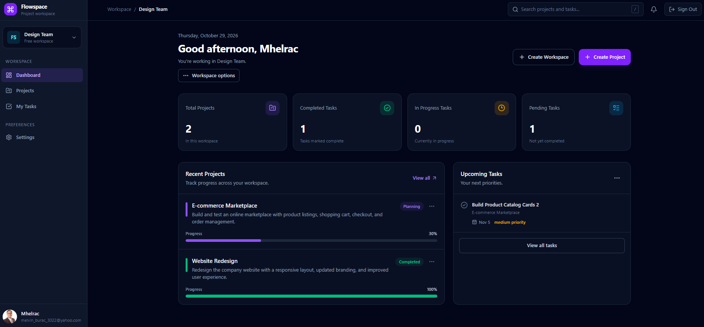

# Flowspace — Project Management SaaS

<p align="center">
  
</p>

<h1 align="center">Flowspace</h1>

<p align="center">
  <strong>Plan smarter. Collaborate better. Get things done.</strong>
</p>

<p align="center">
  A modern project management application designed to help teams organize projects, manage tasks, track progress, and keep work moving forward.
</p>

<p align="center">
  <a href="https://project-management-saas-duqi.vercel.app/"><strong>🚀 Live Demo</strong></a>
  &nbsp; · &nbsp;
  <a href="https://github.com/Melvin-12143031/project-management-saas"><strong>💻 Source Code</strong></a>
</p>

<p align="center">
  
  
  
  
  
</p>

---

## ✨ Overview

**Flowspace** is a full-stack-style project management SaaS portfolio application built with React and Supabase. It brings project organization, task tracking, workspace management, and account settings into one cohesive interface.

The project focuses on practical application development, including authentication, database-backed CRUD operations, protected routes, reusable components, and a production deployment workflow.

## 📸 Application Preview

> The screenshot will be added to `public/screenshot.png` before the next GitHub update.

<p align="center">
  
</p>

<p align="center">
  <em>Flowspace dashboard — project progress and task management in one place.</em>
</p>

## 🚀 Features

### 📊 Dashboard
- Overview of projects and tasks.
- Project progress indicators.
- Quick access to important project information.
- Summary counts for task activity.

### 🗂️ Project Management
- Create, view, edit, and delete projects.
- Organize projects within workspaces.
- Track project status, due dates, and progress.
- View project information from the dashboard and project pages.

### ✅ Task Management
- Create and manage tasks associated with projects.
- Edit task details and update task status.
- Set task priorities and due dates.
- Search tasks and filter by status or priority.
- View task counts and completion progress.

### 🏢 Workspace Management
- Create and manage workspaces.
- Organize projects and tasks by workspace.
- Associate workspace membership with authenticated users.
- Apply database access policies to workspace-related data.

### 🔔 Notifications
- View relevant project and task notifications.
- Navigate from notifications to the related project or task.

### 👤 Authentication & Account Settings
- User registration and sign-in with Supabase Auth.
- Protected application routes.
- Profile management.
- Avatar support.
- Account notification preferences.
- Sign-out functionality.

### 🔐 Security
- Supabase Row Level Security (RLS) policies for database access.
- Environment variables for application configuration.
- No committed local environment file or service-role credentials.

## 🛠️ Tech Stack

| Technology | Purpose |
|---|---|
| React | Component-based user interface |
| Vite | Development server and production build |
| Tailwind CSS | Utility-first styling |
| React Router | Client-side navigation and protected routes |
| Supabase | Authentication, PostgreSQL database, and data access |
| Lucide React | Interface icons |
| Sonner | Toast notifications |
| Vercel | Frontend hosting and deployment |
| Git & GitHub | Version control and source hosting |

## 🧱 Architecture Highlights

Flowspace separates the interface, application state, and data access into focused parts of the codebase.

- **Pages** — dashboard, projects, tasks, authentication, and settings.
- **Components** — reusable forms, dialogs, and confirmation interfaces.
- **Contexts** — authentication and workspace state.
- **Services** — project, task, workspace, and notification operations.
- **Supabase** — persistent data storage and authentication.
- **Protected routes** — restrict access to authenticated application areas.

This structure makes the application easier to maintain and provides a foundation for future enhancements.

## ⚙️ Getting Started

Want to run Flowspace locally? Follow these steps.

### Prerequisites

- [Node.js](https://nodejs.org/) (an active LTS version recommended)
- npm
- A [Supabase](https://supabase.com/) project

### 1. Clone the repository

```bash
git clone https://github.com/Melvin-12143031/project-management-saas.git
cd project-management-saas
```

### 2. Install dependencies

```bash
npm install
```

### 3. Configure environment variables

Create a `.env.local` file in the project root:

```env
VITE_SUPABASE_URL=your_supabase_project_url
VITE_SUPABASE_PUBLISHABLE_KEY=your_supabase_publishable_key
```

Replace the placeholder values with the corresponding values from your Supabase project.

**Security:** Never commit `.env.local` or place a Supabase secret/service-role key in a client-side `VITE_` environment variable.

### 4. Start the development server

```bash
npm run dev
```

Open the local URL printed in your terminal.

### 5. Build for production

```bash
npm run build
```

To test the production build locally:

```bash
npm run preview
```

## 🌐 Live Deployment

Try the deployed application:

**[Launch Flowspace →](https://project-management-saas-duqi.vercel.app/)**

Flowspace is hosted on Vercel, with Supabase providing authentication and database services.

## 🔒 Environment & Database Setup

Flowspace requires a configured Supabase project with the application's database schema, authentication settings, and appropriate Row Level Security policies.

The repository includes a `supabase queries/` directory containing SQL scripts used during development.

Before using a fresh Supabase project:

1. Review the SQL scripts and apply the required schema and policies in the correct order.
2. Configure authentication and email-confirmation settings as needed.
3. Set the correct environment variables in your local environment and Vercel.
4. Verify database access policies before using real user data.

Never expose private credentials or disable RLS as a shortcut for deployment.

## 🗺️ Future Improvements

Potential areas for continued development include:

- Team invitations and richer collaboration workflows.
- Kanban-style task boards.
- More advanced project reporting and analytics.
- Improved loading performance through code splitting.
- Expanded automated testing.

These are possible future enhancements, not claims about existing functionality.

## 💡 What This Project Demonstrates

Flowspace is part of my full-stack web development portfolio and demonstrates my work with:

- Building a multi-page React application.
- Designing reusable components and organizing application logic.
- Implementing authentication and protected routes.
- Integrating Supabase with database-backed CRUD workflows.
- Working with PostgreSQL access policies and environment configuration.
- Building and deploying a production frontend with Vercel.
- Managing source code and project changes through Git and GitHub.

## 👨‍💻 Author

**Melvin**

GitHub: [@Melvin-12143031](https://github.com/Melvin-12143031)

---

<p align="center">
  <strong>Flowspace — Make work flow.</strong>
</p>

<p align="center">
  Built as a full-stack web development portfolio project.
</p>